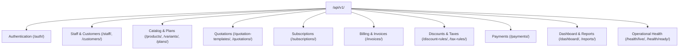

# Brightloop Software — Subscription Management System

## Complete Minimal REST API Catalog & Endpoint Inventory

**Document Version:** 1.0.0  
**Base URL:** `/api/v1/`  
**OpenAPI Specification:** `/api/schema/`  
**Interactive Swagger UI:** `/api/docs/`  
**Design Principle:** Resource-oriented, minimal API surface, strict backend authorization, zero single-purpose button endpoints.

---

## 1. Summary of API Surface

The API exposes **26 route templates** supporting all 12 core requirements without redundant endpoints:



---

## 2. Detailed Endpoint Inventory

### A. Authentication & Account Management

#### 1. Customer Self-Registration

- **Method & Path:** `POST /api/v1/auth/register/`
- **Access Level:** Public
- **Purpose:** Public sign-up for small businesses creating Brightloop accounts.
- **Validation Rules:**
  - `email`: Valid, unique email address.
  - `password`: Minimum 8 characters, at least 1 uppercase letter, 1 lowercase letter, 1 special symbol.
- **Request Example:**
  ```json
  {
    "email": "owner@retailshop.com",
    "password": "SecurePassword2026!",
    "first_name": "Elena",
    "last_name": "Rostova",
    "company_name": "Rostova Retail LLC",
    "phone": "+1 555-019-2834"
  }
  ```
- **Response (201 Created):**
  ```json
  {
    "id": "c7a6e118-9712-4cf4-921a-e89c03b1e90a",
    "email": "owner@retailshop.com",
    "role": "CUSTOMER",
    "company_name": "Rostova Retail LLC"
  }
  ```

#### 2. User Login

- **Method & Path:** `POST /api/v1/auth/login/` (or `/api/v1/auth/token/`)
- **Access Level:** Public
- **Purpose:** Authenticates user and issues access token in response body and refresh token in secure `httpOnly` cookie.
- **Request Example:**
  ```json
  {
    "email": "admin@brightloop.com",
    "password": "BrightloopAdmin2026!"
  }
  ```
- **Response (200 OK):**
  ```json
  {
    "access": "eyJhbGciOiJIUzI1NiIsIn...",
    "user": {
      "id": "e4b52b21-4f10-449e-b8d2-43187a3cb98e",
      "email": "admin@brightloop.com",
      "role": "ADMIN"
    }
  }
  ```

#### 3. Refresh Authentication Token

- **Method & Path:** `POST /api/v1/auth/token/refresh/`
- **Access Level:** Public (reads httpOnly refresh cookie or Bearer payload)
- **Purpose:** Exchanges valid refresh token for a newly issued short-lived access token.
- **Response (200 OK):**
  ```json
  {
    "access": "eyJhbGciOiJIUzI1NiIsIn..."
  }
  ```

#### 4. User Logout

- **Method & Path:** `POST /api/v1/auth/logout/`
- **Access Level:** Authenticated
- **Purpose:** Invalidates refresh token and clears httpOnly session cookie.
- **Response (200 OK):** `{"detail": "Successfully logged out."}`

#### 5. Current User Identity (`Me`)

- **Method & Path:** `GET /api/v1/auth/me/`
- **Access Level:** Authenticated
- **Purpose:** Returns authenticated user profile, assigned role (`ADMIN`, `STAFF`, `CUSTOMER`), and customer link.
- **Response (200 OK):**
  ```json
  {
    "id": "e4b52b21-4f10-449e-b8d2-43187a3cb98e",
    "email": "staff@brightloop.com",
    "first_name": "Sarah",
    "last_name": "Jenkins",
    "role": "STAFF",
    "is_active": true
  }
  ```

#### 6. Request Password Reset

- **Method & Path:** `POST /api/v1/auth/password-reset/`
- **Access Level:** Public
- **Purpose:** Triggers password reset token delivery to the registered email address.
- **Request:** `{"email": "customer@acme.com"}`
- **Response (200 OK):** `{"detail": "If the account exists, a password reset link has been dispatched."}`

#### 7. Confirm Password Reset

- **Method & Path:** `POST /api/v1/auth/password-reset/confirm/`
- **Access Level:** Public
- **Validation:** Validates token and enforces Brightloop strong password rules.
- **Request:** `{"token": "xyz...", "new_password": "NewStrongPass2026!"}`
- **Response (200 OK):** `{"detail": "Password has been successfully updated."}`

---

### B. Staff & Customers

#### 8. Manage Staff Members

- **Method & Path:** `GET, POST /api/v1/staff/`
- **Access Level:** Admin Only
- **Purpose:** Lists all internal staff or provisions a new internal staff member. Only Admin can execute.
- **Request (POST):**
  ```json
  {
    "email": "ops@brightloop.com",
    "password": "BrightloopOps2026!",
    "first_name": "Marcus",
    "last_name": "Vance",
    "role": "STAFF"
  }
  ```

#### 9. Staff Detail & Deactivation

- **Method & Path:** `GET, PATCH /api/v1/staff/{id}/` and `POST /api/v1/staff/{id}/deactivate/`
- **Access Level:** Admin Only
- **Purpose:** Retrieve staff profile, update permissions, or deactivate access.

#### 10. Customers Collection

- **Method & Path:** `GET, POST /api/v1/customers/`
- **Access Level:** Staff & Admin (read/write); Customers (denied)
- **Query Parameters:** `?search=Acme`, `?ordering=company_name`, `?page=1`
- **Request (POST):**
  ```json
  {
    "company_name": "TechTrend Dynamics",
    "contact_name": "Elena Rostova",
    "email": "finance@techtrend.io",
    "phone": "+1 555-018-9922",
    "billing_address": "100 Market St, San Francisco, CA",
    "tax_id": "US-123456789"
  }
  ```

#### 11. Customer Detail & Self-Profile

- **Method & Path:** `GET, PATCH /api/v1/customers/{id}/` and `GET, PATCH /api/v1/customers/me/`
- **Access Level:** Staff/Admin (all customers); Customer (`/me/` and own `{id}` only).

---

### C. Products, Variants & Subscription Plans

#### 12. Products Resource

- **Method & Path:** `GET, POST /api/v1/products/` and `GET, PATCH /api/v1/products/{id}/`
- **Access Level:** Staff/Admin (write); Authenticated (read)
- **Fields:** `name`, `code`, `product_type` (`software`, `addon`, `service`, `physical`), `sales_price`, `cost_price`, `notes`, `is_active`.

#### 13. Product Variants Resource

- **Method & Path:** `GET, POST /api/v1/products/{id}/variants/` and `PATCH /api/v1/variants/{id}/`
- **Access Level:** Staff/Admin (write); Authenticated (read)
- **Purpose:** Manages attribute deltas (e.g., Attribute: `Brand`, Value: `Odoo Integration`, Price Delta: `+560.00`).
- **Price Calculation:** $\text{Effective Unit Price} = \text{Product.sales\_price} + \text{Variant.price\_delta}$.

#### 14. Subscription Plans Resource

- **Method & Path:** `GET, POST /api/v1/plans/` and `GET, PATCH /api/v1/plans/{id}/`
- **Access Level:** Admin (write); Authenticated (read)
- **Fields:** `name`, `code`, `billing_frequency` (`daily`, `weekly`, `monthly`, `yearly`), `cost`, `minimum_quantity`, `start_date`, `end_date`, `auto_close_on_end`, `allow_early_close`, `allow_pause`, `allow_renew`, `is_active`.

---

### D. Quotations & Templates

#### 15. Quotation Templates

- **Method & Path:** `GET, POST /api/v1/quotation-templates/` and `GET, PATCH /api/v1/quotation-templates/{id}/`
- **Access Level:** Staff & Admin
- **Purpose:** Reusable templates storing predefined plans, line items, and validity windows in days.

#### 16. Quotations Resource & Action Transitions

- **Method & Path:** `GET, POST /api/v1/quotations/`, `GET /api/v1/quotations/{id}/`, and `POST /api/v1/quotations/{id}/actions/`
- **Access Level:** Staff & Admin; Customers (read own offer)
- **Action Types (`POST /actions/`):**
  - `send`: Dispatches quotation to customer email with expiration timer.
  - `convert`: Converts confirmed quotation directly into an active subscription.

---

### E. Subscriptions Lifecycle

#### 17. Subscriptions Collection & Detail

- **Method & Path:** `GET, POST /api/v1/subscriptions/` and `GET, PATCH /api/v1/subscriptions/{id}/`
- **Access Level:** Staff/Admin (all subscriptions); Customer (scoped to own subscriptions)
- **Query Parameters:** `?status=active`, `?customer={id}`, `?search=SUB-2026`, `?ordering=-created_at`
- **Rule:** Direct PATCH cannot bypass the lifecycle state machine.

#### 18. Subscription Business Actions

- **Method & Path:** `POST /api/v1/subscriptions/{id}/actions/`
- **Access Level:** Staff/Admin; Customer (limited self-actions based on plan policies)
- **Actions Payload:**
  ```json
  {
    "action": "confirm" // Choices: "to_quotation", "confirm", "activate", "pause", "resume", "renew", "close"
  }
  ```
- **State Machine Validation Rules:**
  - `pause`: Allowed only if `plan.allow_pause == true`.
  - `close` (early termination): Allowed only if `plan.allow_early_close == true` or reached expiry.
  - `renew`: Permitted only if `plan.allow_renew == true`.

---

### F. Billing, Invoices & PDF Generation

#### 19. Invoices Collection & Detail

- **Method & Path:** `GET /api/v1/invoices/` and `GET /api/v1/invoices/{id}/`
- **Access Level:** Staff/Admin (all); Customer (own invoices only)
- **Query Parameters:** `?status=confirmed`, `?overdue=true`, `?customer={id}`

#### 20. Invoice Actions & PDF Generation

- **Method & Path:** `POST /api/v1/invoices/{id}/actions/` and `GET /api/v1/invoices/{id}/pdf/`
- **Actions:** `confirm` (transitions Draft $\to$ Confirmed), `cancel` (cancels unpaid invoice), `send` (dispatches invoice notification).
- **PDF Output:** Serves downloadable, printable invoice document with tax and discount breakdowns.

---

### G. Discounts & Taxes

#### 21. Discount Rules Resource

- **Method & Path:** `GET, POST /api/v1/discount-rules/` and `GET, PATCH /api/v1/discount-rules/{id}/`
- **Access Level:** Admin Only
- **Fields:** `name`, `code`, `discount_type` (`percentage`, `fixed`), `value`, `min_purchase_amount`, `min_quantity`, `start_date`, `end_date`, `max_uses`, `times_used`, `scope` (`product`, `subscription`), `target_product`, `is_active`.

#### 22. Tax Rules Resource

- **Method & Path:** `GET, POST /api/v1/tax-rules/` and `GET, PATCH /api/v1/tax-rules/{id}/`
- **Access Level:** Admin Only
- **Fields:** `name`, `rate_percent`, `is_active`.

---

### H. Payments

#### 23. Payments Resource

- **Method & Path:** `GET, POST /api/v1/payments/` and `GET /api/v1/payments/{id}/`
- **Access Level:** Staff/Admin; Customer (view own settled payments)
- **Request (POST):**
  ```json
  {
    "invoice": "4a7b5e82-36c1-4b11-9a72-f1295cb4d110",
    "amount": "1162.70",
    "payment_method": "bank_transfer",
    "payment_date": "2026-10-31",
    "reference": "WIRE-REF-9021",
    "notes": "Acme monthly payment cleared."
  }
  ```
- **Transactional Guarantee:** Payment recording atomically updates `invoice.paid_amount`, recalculates `outstanding_balance`, and transitions invoice to `PAID` when fully settled.

---

### I. Executive Dashboard & Financial Reports

#### 24. Executive Dashboard Aggregation

- **Method & Path:** `GET /api/v1/dashboard/summary/` (and `/api/v1/reporting/dashboard/`)
- **Access Level:** Staff & Admin
- **Response (200 OK):**
  ```json
  {
    "kpis": {
      "active_subscriptions": 24,
      "total_subscriptions": 32,
      "mrr": 18450.0,
      "arr": 221400.0,
      "total_revenue_collected": 94820.5,
      "total_outstanding": 3450.0,
      "overdue_invoices_count": 2,
      "overdue_amount": 767.8
    },
    "status_distribution": {
      "active": 24,
      "paused": 2,
      "quotation": 4,
      "closed": 2
    },
    "revenue_trend": [
      { "month": "May 2026", "revenue": 14200.0 },
      { "month": "Jun 2026", "revenue": 16100.0 },
      { "month": "Jul 2026", "revenue": 18450.0 }
    ]
  }
  ```

#### 25. Consolidated Financial Reports

- **Method & Path:** `GET /api/v1/reports/`
- **Access Level:** Staff & Admin
- **Query Parameters:** `?type=revenue|subscriptions|receivables`, `?start_date=2026-01-01`, `?end_date=2026-10-31`

---

### J. Operational Health Checks

#### 26. Health Liveness & Readiness Endpoints

- **Method & Path:**
  - `GET /api/v1/health/live/`: Application process liveness (responds `{"status": "live"}`).
  - `GET /api/v1/health/ready/`: Dependency readiness probe verifying PostgreSQL database and Redis connectivity.
- **Access Level:** Public

---

## 3. Background Operations (Celery Scheduled Tasks — NOT Public APIs)

The following automated operations run asynchronously via Celery Beat and are **deliberately excluded from public API endpoints**:

| Celery Task Name                                  | Schedule          | Purpose                                                                                                                                      |
| ------------------------------------------------- | ----------------- | -------------------------------------------------------------------------------------------------------------------------------------------- |
| `billing.tasks.run_recurring_billing_cycle`       | Daily (00:05 UTC) | Finds due active subscriptions (`next_billing_date <= today`), creates pre-filled invoices with idempotency keys, and advances cycle anchor. |
| `subscriptions.tasks.check_subscription_renewals` | Daily (01:00 UTC) | Checks subscriptions reaching expiry date; triggers auto-renew if `allow_renew == true`.                                                     |
| `subscriptions.tasks.enforce_subscription_expiry` | Daily (01:15 UTC) | Automatically marks subscriptions as `CLOSED` if expiry date reached and `auto_close_on_end == true`.                                        |
| `billing.tasks.check_overdue_invoices`            | Hourly            | Flags confirmed invoices with positive outstanding balances past due date as overdue.                                                        |
| `billing.tasks.enforce_discount_limits`           | Daily (02:00 UTC) | Deactivates discount rules that have reached `end_date` or exceeded `max_uses`.                                                              |
| `notifications.tasks.dispatch_invoice_emails`     | On Event / Queue  | Delivers invoice PDFs and payment receipts via email.                                                                                        |
