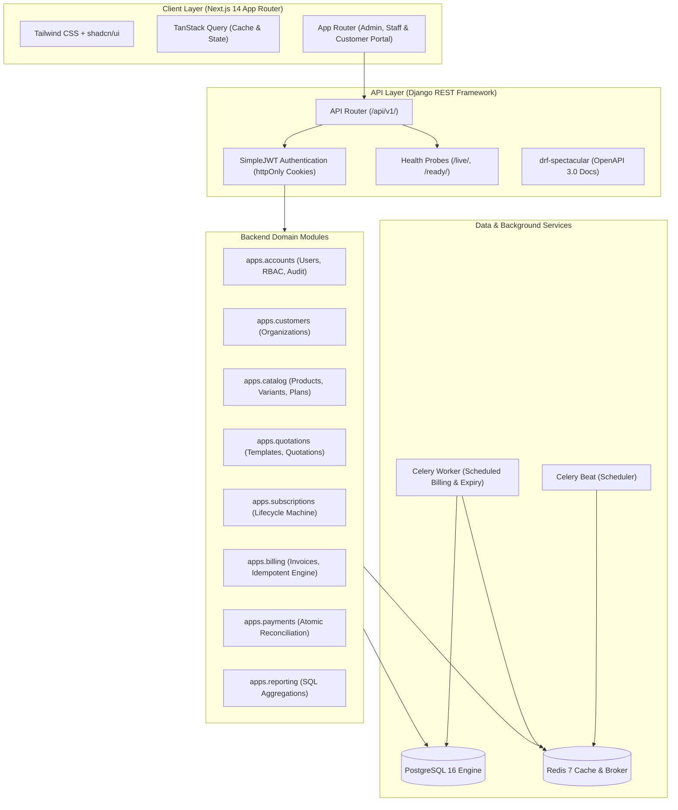

# Brightloop Software — Subscription Management System

## System Architecture & Domain Design

**Document Version:** 2.0.0  
**Pattern:** Modular Monolith with Asynchronous Task Workers  
**SLA:** Sub-2.0 second responses with tens of thousands of active subscriptions

---

## 1. Architectural Strategy: Modular Monolith

To achieve high developer velocity, maintainability, strong transaction consistency, and sub-2-second response times without the operational failure modes of microservices, Brightloop is engineered as a **Modular Monolith**.

---

## 2. Domain Module Responsibilities

1. **`accounts`**: Custom user identity model (`AbstractUser`), roles (`ADMIN`, `STAFF`, `CUSTOMER`), complex password policy validator, SimpleJWT auth, and `AuditLog` entity.
2. **`customers`**: Customer company profile, contact details, billing address, tax identification.
3. **`catalog`**: Products (`software`, `addon`, `service`, `physical`), attribute-based variants with price adjustments, subscription plans with billing frequencies (`daily`, `weekly`, `monthly`, `yearly`) and lifecycle policy flags (`auto_close_on_end`, `allow_early_close`, `allow_pause`, `allow_renew`).
4. **`quotations`**: Quotation templates and pre-filled lines with configurable validity durations in days.
5. **`subscriptions`**: Subscription agreements, line items, state transitions ($\text{Draft} \to \text{Quotation} \to \text{Confirmed} \to \text{Active} \leftrightarrow \text{Paused} \to \text{Closed}$), renewal and expiry tracking.
6. **`billing`**: Tax rules, Discount rules (fixed vs. percentage, limits, product/subscription scope), Invoices, InvoiceLine items, idempotent automated billing engine (`sub_{id}_{date}`).
7. **`payments`**: Multi-method payment recording against invoices, atomic balance updates, overdue tracking.
8. **`reporting`**: Consolidated high-performance dashboard aggregations (MRR, ARR, active counts, overdue breakdown) executed via database SQL aggregates.

---

## 3. High Performance & Low Latency Strategy

To guarantee that dashboards and listings respond in **under 2.0 seconds** with tens of thousands of active subscriptions:

1. **Targeted Composite Indexing**:
   - `subscriptions_subscription (status, next_billing_date)`
   - `subscriptions_subscription (customer, status)`
   - `billing_invoice (status, due_date)`
   - `billing_invoice (customer, status)`
   - `payments_payment (invoice_id, payment_date)`
2. **Database-Level Aggregation**:
   - The reporting module calculates MRR and overdue sums using single-query SQL `aggregate(Sum(...), Count(...))` instead of loading records into Python memory.
3. **Optimized ORM Fetching**:
   - Zero N+1 queries. All serializers enforce strict `select_related('customer', 'plan')` and `prefetch_related('lines__product', 'lines__variant')`.
4. **Client-Side Stale-While-Revalidate**:
   - TanStack Query caches dashboard and list views with configurable 30s staleness, preventing redundant network trips on page navigation.

---

## 4. Security & Compliance Principles

- **Secure Token Architecture**: Access tokens (30 min) in Authorization headers; refresh tokens (7 days) stored securely in `httpOnly`, `SameSite=Lax` cookies. No long-lived tokens in localStorage.
- **Strict Role-Based Access Control (RBAC)**:
  - `IsAdmin`: Unrestricted configuration.
  - `IsStaffOrAdmin`: Operational execution (quotes, invoices, payments) but cannot modify tax or discount rules or manage staff accounts.
  - `IsCustomer`: Scoped exclusively to objects where `customer.user == request.user`.
- **Idempotency in Billing**: Automated recurring billing runs generate deterministic billing hashes (`sub_{subscription_id}_{billing_period_date}`) preventing duplicate charges if re-run.
- **Audit Logging**: Sensitive lifecycle actions (`pause`, `close`, `invoice.confirm`, `payment.record`) generate structured `AuditLog` records with user, timestamp, and IP address.
