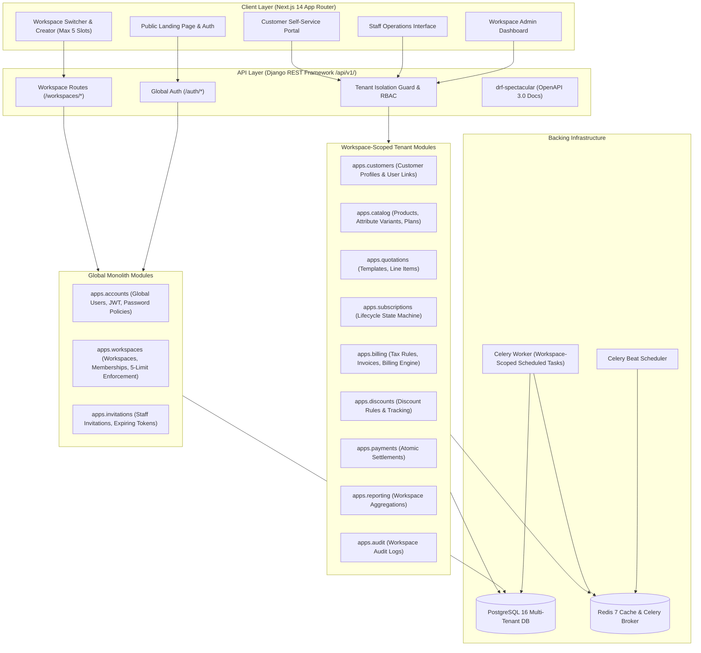
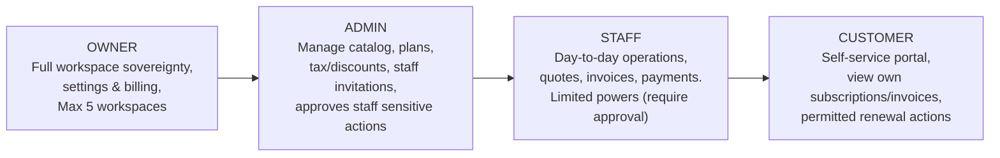

# Brightloop Software — Multi-Tenant Subscription SaaS Platform

## System Architecture & Multi-Tenant Design

**Document Version:** 3.0.0 (Multi-Tenant SaaS Architecture)  
**Pattern:** Multi-Tenant Modular Monolith with Asynchronous Task Workers  
**SLA:** Sub-2.0 second responses across thousands of tenant workspaces

---

## 1. Architectural Strategy: Multi-Tenant Modular Monolith

The platform is designed as a **Multi-Tenant Modular Monolith**. Anyone can register a global account, create and run up to 5 business workspaces, invite staff, manage customer accounts, and automate subscription billing with complete data isolation.

---

## 2. Multi-Tenant Identity & Authorization Model

### 2.1 Identity Decomposition

1. **User (`User`)**: Global user identity across the platform. Holds email, hashed password, personal name, and global flags (`is_active`, `is_staff`, `is_superuser`).
2. **Workspace (`Workspace`)**: Independent business organization. Owns products, subscriptions, invoices, and customers. A user can own a maximum of **5 workspaces**.
3. **WorkspaceMembership (`WorkspaceMembership`)**: Association table binding a `User` to a `Workspace` with a workspace role (`OWNER`, `ADMIN`, `STAFF`, `CUSTOMER`).
4. **StaffInvitation (`StaffInvitation`)**: Cryptographically random expiring tokens allowing business creators to invite administrators and staff members to their workspace.
5. **CustomerProfile (`CustomerProfile`)**: Workspace-specific customer account.
6. **CustomerUserLink (`CustomerUserLink`)**: Links a workspace customer profile to a global user account for customer portal access.

### 2.2 Roles & Operational Powers

- **OWNER**: Complete sovereignty over the workspace, billing information, member roles, and deletion.
- **ADMIN**: Configuration of catalog, pricing, tax/discount rules, customer accounts, and approval of sensitive staff requests.
- **STAFF**: Operational day-to-day duties. Limited powers; discounts exceeding limits, manual cancellations, or debt write-offs require Admin approval.
- **CUSTOMER**: Access strictly restricted to customer's linked profile and own financial records.

---

## 3. Strict Tenant Isolation Strategy

### 3.1 Route-Level Scoping

All tenant operations are scoped under `/api/v1/workspaces/{workspace_id}/...`. The `workspace_id` in the URL path is canonical. Any workspace identifier passed in the request body is either discarded or validated to match the route.

### 3.2 Queryset Isolation & Membership Validation

Every DRF view or viewset handling tenant data inherits a base workspace mixin or permission check:

1. Validates that the active user possesses an active `WorkspaceMembership` in the specified workspace.
2. Evaluates the user's role against the required action permissions.
3. Automatically overrides `get_queryset()` to filter by `workspace_id=workspace_id`.
4. Overrides `perform_create()` to inject `workspace_id` directly from the URL context.

### 3.3 Relational & Foreign-Key Integrity

- All tenant tables (`Product`, `SubscriptionPlan`, `Quotation`, `Subscription`, `Invoice`, `Payment`, `AuditLog`, etc.) maintain a foreign key to `Workspace`.
- Cross-workspace foreign key references are strictly prevented by relational constraints and serializer validation.

### 3.4 Asynchronous Worker Tenancy

All Celery background tasks (recurring billing runs, subscription renewal processing, invoice overdue checks) explicitly accept `workspace_id` as an execution parameter, ensuring scheduled jobs run inside the correct tenant context.

---

## 4. Financial Consistency & Idempotent Processing

1. **Exact Decimal Precision**: All monetary calculations utilize Python's `Decimal` with `Decimal(12, 2)` storage in PostgreSQL.
2. **Deterministic Idempotency Key**:
   $$\text{Key} = \text{ws\_}\{workspace\_id\}\_\text{sub\_}\{subscription\_id\}\_\text{date\_}\{YYYY-MM-DD\}$$
   Prevents double-invoicing or duplicate charges during retry cycles.
3. **Atomic State Transitions**: Subscription transitions, invoice settlements, and balance updates execute within PostgreSQL atomic transactions (`transaction.atomic()`).

---

## 5. Sub-2-Second Query Performance

- **Composite Database Indexes**: `(workspace_id, status)`, `(workspace_id, customer_id)`, `(workspace_id, next_billing_date)`.
- **Database-Level Aggregation**: Executive dashboard statistics (MRR, ARR, collections, overdue aging) are calculated directly via SQL `annotate()`, `aggregate()`, and `Coalesce()`, avoiding loading thousands of objects into Python memory.
