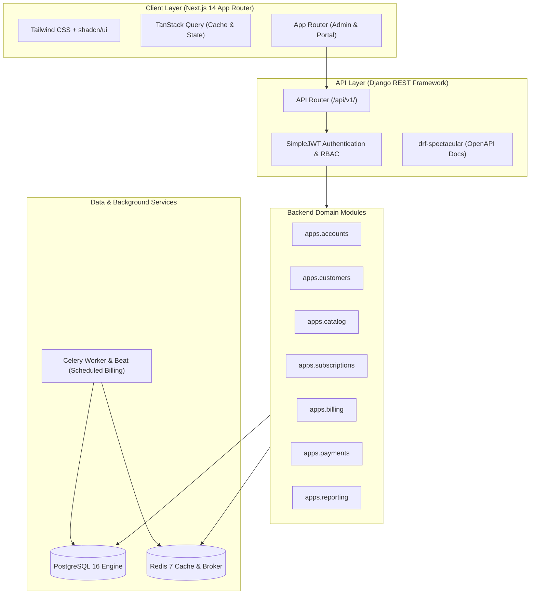

# Brightloop Software — Subscription Management System
## System Architecture & Domain Design

---

## 1. Architectural Strategy: Modular Monolith

To achieve maximum developer velocity, maintainability, strong transaction consistency, and sub-2-second response times without the distributed failure modes of microservices, Brightloop is engineered as a **Modular Monolith**.

---

## 2. Domain Module Responsibilities

1. **`accounts`**: Custom user identity model (`AbstractUser`), roles (`ADMIN`, `STAFF`, `CUSTOMER`), password policy enforcement, token authentication & refresh cookies.
2. **`customers`**: Customer company profile, contact details, billing address, tax identification.
3. **`catalog`**: Products (`software`, `addon`, `service`, `physical`), attribute-based variants with price adjustments, subscription plans with billing frequencies (`daily`, `weekly`, `monthly`, `yearly`) and lifecycle policy flags (`auto_close_on_end`, `allow_early_close`, `allow_pause`, `allow_renew`).
4. **`quotations`**: Quotation templates and pre-filled lines with configurable validity durations.
5. **`subscriptions`**: Subscription agreements, line items, state transitions (`draft` $\to$ `quotation` $\to$ `confirmed` $\to$ `active` $\leftrightarrow$ `paused` $\to$ `closed`), renewal & expiry tracking.
6. **`billing`**: Tax rules, Discount rules (fixed vs. percentage, limits, product/subscription scope), Invoices, InvoiceLine items, idempotent automated billing engine.
7. **`payments`**: Multi-method payment recording against invoices, dynamic balance calculation, overdue tracking.
8. **`reporting`**: Consolidated high-performance dashboard aggregations (MRR, ARR, active counts, overdue breakdown).

---

## 3. High Performance & Low Latency Strategy

To guarantee that dashboards and listings respond in **under 2.0 seconds** with tens of thousands of active subscriptions:
1. **Targeted Composite Indexing**:
   - `subscriptions_subscription (status, start_date, expiry_date)`
   - `billing_invoice (status, due_date, customer_id)`
   - `payments_payment (invoice_id, payment_date)`
2. **Database-Level Aggregation**:
   - The reporting module calculates MRR and overdue sums using single-query SQL `aggregate(Sum(...), Count(...))` instead of loading records into Python memory.
3. **Optimized ORM Fetching**:
   - Zero N+1 queries. All serializers enforce strict `select_related('customer', 'plan')` and `prefetch_related('lines__product', 'lines__variant')`.
4. **Client-Side Stale-While-Revalidate**:
   - TanStack Query caches dashboard and list views with configurable 30s-60s staleness, preventing redundant network trips on page navigation.

---

## 4. Security & Compliance Principles

- **No Secret Storage in Frontend**: Access tokens are kept in secure memory or short-lived headers; refresh tokens are transferred in secure, httpOnly cookies with CSRF protection.
- **Strict Role-Based Access Control (RBAC)**:
  - `IsAdminUser`: Unrestricted configuration.
  - `IsStaffUser`: Operational execution (quotes, invoices, payments) but cannot modify tax or discount rules or manage staff accounts.
  - `IsCustomerUser`: Scoped exclusively to objects where `customer.user == request.user`.
- **Idempotency in Billing**: Automated recurring billing runs generate deterministic billing hashes (`subscription_id + billing_period_date`) preventing duplicate charges if re-run.
