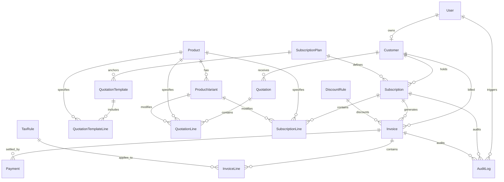

# Brightloop Software — Subscription Management System

## Database Design & Entity Relationship Model

**Document Version:** 2.0.0  
**Target Database Engine:** PostgreSQL 16+  
**Design Principle:** Strong transactional consistency, strict referential integrity, decimal precision for monetary figures, optimized composite indexing for sub-2-second queries.

---

## 1. Entity-Relationship Diagram

---

## 2. Entity Specifications

### 2.1 `accounts_user`

- `id`: UUID (Primary Key)
- `email`: VARCHAR(255) UNIQUE NOT NULL INDEX (Username field)
- `first_name`: VARCHAR(150)
- `last_name`: VARCHAR(150)
- `role`: VARCHAR(20) NOT NULL (`ADMIN`, `STAFF`, `CUSTOMER`)
- `is_active`: BOOLEAN DEFAULT TRUE
- `created_at`, `updated_at`: TIMESTAMP WITH TIME ZONE

### 2.2 `customers_customer`

- `id`: UUID (Primary Key)
- `user`: FK(User, null=True, blank=True, on_delete=SET_NULL, related_name='customer_profile')
- `company_name`: VARCHAR(255) NOT NULL INDEX
- `contact_name`: VARCHAR(255) NOT NULL
- `email`: VARCHAR(255) NOT NULL INDEX
- `phone`: VARCHAR(50)
- `billing_address`: TEXT
- `tax_id`: VARCHAR(50)
- `created_at`, `updated_at`: TIMESTAMP WITH TIME ZONE

### 2.3 `catalog_product` & `catalog_productvariant`

- **Product**:
  - `id`: UUID (PK)
  - `name`: VARCHAR(255) NOT NULL
  - `code`: VARCHAR(50) UNIQUE NOT NULL INDEX
  - `product_type`: VARCHAR(20) (`software`, `addon`, `service`, `physical`)
  - `sales_price`: DECIMAL(12, 2) NOT NULL (Positive financial decimal)
  - `cost_price`: DECIMAL(12, 2) DEFAULT 0.00
  - `notes`: TEXT
  - `is_active`: BOOLEAN DEFAULT TRUE
- **ProductVariant**:
  - `id`: UUID (PK)
  - `product`: FK(Product, on_delete=CASCADE, related_name='variants')
  - `attribute_name`: VARCHAR(100) (e.g., "Brand", "Edition")
  - `attribute_value`: VARCHAR(100) (e.g., "Odoo Integration", "Enterprise")
  - `price_delta`: DECIMAL(12, 2) DEFAULT 0.00 (e.g., +560.00)
  - _Constraint:_ `UNIQUE(product, attribute_name, attribute_value)`

### 2.4 `catalog_subscriptionplan`

- `id`: UUID (PK)
- `name`: VARCHAR(255) NOT NULL
- `code`: VARCHAR(50) UNIQUE NOT NULL INDEX
- `billing_frequency`: VARCHAR(20) (`daily`, `weekly`, `monthly`, `yearly`)
- `cost`: DECIMAL(12, 2) NOT NULL
- `minimum_quantity`: INTEGER DEFAULT 1
- `start_date`: DATE NULL
- `end_date`: DATE NULL
- **Policies**:
  - `auto_close_on_end`: BOOLEAN DEFAULT TRUE
  - `allow_early_close`: BOOLEAN DEFAULT TRUE
  - `allow_pause`: BOOLEAN DEFAULT TRUE
  - `allow_renew`: BOOLEAN DEFAULT TRUE
  - `is_active`: BOOLEAN DEFAULT TRUE

### 2.5 `quotations_quotationtemplate` & `quotations_quotation`

- **QuotationTemplate**:
  - `id`: UUID (PK)
  - `name`: VARCHAR(255)
  - `plan`: FK(SubscriptionPlan, on_delete=PROTECT)
  - `validity_days`: INTEGER DEFAULT 30
- **Quotation**:
  - `id`: UUID (PK)
  - `quotation_number`: VARCHAR(50) UNIQUE NOT NULL INDEX
  - `customer`: FK(Customer, on_delete=PROTECT)
  - `plan`: FK(SubscriptionPlan, on_delete=PROTECT)
  - `status`: VARCHAR(20) (`draft`, `sent`, `accepted`, `expired`, `converted`)
  - `valid_until`: DATE NOT NULL
  - `total_amount`: DECIMAL(12, 2) NOT NULL

### 2.6 `subscriptions_subscription` & `subscriptions_subscriptionline`

- **Subscription**:
  - `id`: UUID (PK)
  - `subscription_number`: VARCHAR(50) UNIQUE NOT NULL INDEX (e.g., `SUB-2026-0001`)
  - `customer`: FK(Customer, on_delete=PROTECT, related_name='subscriptions')
  - `plan`: FK(SubscriptionPlan, on_delete=PROTECT, related_name='subscriptions')
  - `status`: VARCHAR(20) (`draft`, `quotation`, `confirmed`, `active`, `paused`, `closed`) INDEX
  - `start_date`: DATE NOT NULL
  - `expiry_date`: DATE NULL
  - `next_billing_date`: DATE NULL INDEX
  - `payment_terms`: VARCHAR(20) (`due_on_receipt`, `net_15`, `net_30`, `net_60`)
  - `subtotal`: DECIMAL(12, 2) DEFAULT 0.00
  - `tax_amount`: DECIMAL(12, 2) DEFAULT 0.00
  - `discount_amount`: DECIMAL(12, 2) DEFAULT 0.00
  - `total_amount`: DECIMAL(12, 2) DEFAULT 0.00
  - _Indexes:_ `(status, next_billing_date)`, `(customer, status)`
- **SubscriptionLine**:
  - `id`: UUID (PK)
  - `subscription`: FK(Subscription, on_delete=CASCADE, related_name='lines')
  - `product`: FK(Product, on_delete=PROTECT)
  - `variant`: FK(ProductVariant, null=True, blank=True, on_delete=SET_NULL)
  - `quantity`: INTEGER DEFAULT 1
  - `unit_price`: DECIMAL(12, 2) NOT NULL
  - `tax_rate`: DECIMAL(5, 2) DEFAULT 0.00
  - `subtotal`: DECIMAL(12, 2) NOT NULL

### 2.7 `billing_taxrule` & `billing_discountrule`

- **TaxRule**:
  - `id`: UUID (PK)
  - `name`: VARCHAR(100) NOT NULL
  - `rate_percent`: DECIMAL(5, 2) NOT NULL
  - `is_active`: BOOLEAN DEFAULT TRUE
- **DiscountRule**:
  - `id`: UUID (PK)
  - `name`: VARCHAR(100) NOT NULL
  - `code`: VARCHAR(50) UNIQUE NOT NULL INDEX
  - `discount_type`: VARCHAR(20) (`percentage`, `fixed`)
  - `value`: DECIMAL(12, 2) NOT NULL
  - `min_purchase_amount`: DECIMAL(12, 2) DEFAULT 0.00
  - `min_quantity`: INTEGER DEFAULT 0
  - `start_date`: DATE NULL
  - `end_date`: DATE NULL
  - `max_uses`: INTEGER NULL
  - `times_used`: INTEGER DEFAULT 0
  - `scope`: VARCHAR(20) (`product`, `subscription`)
  - `target_product`: FK(Product, null=True, blank=True, on_delete=SET_NULL)
  - `is_active`: BOOLEAN DEFAULT TRUE

### 2.8 `billing_invoice` & `billing_invoiceline`

- **Invoice**:
  - `id`: UUID (PK)
  - `invoice_number`: VARCHAR(50) UNIQUE NOT NULL INDEX (e.g., `INV-2026-0001`)
  - `subscription`: FK(Subscription, null=True, on_delete=SET_NULL, related_name='invoices')
  - `customer`: FK(Customer, on_delete=PROTECT, related_name='invoices')
  - `billing_period_start`: DATE NULL
  - `billing_period_end`: DATE NULL
  - `issue_date`: DATE NOT NULL
  - `due_date`: DATE NOT NULL INDEX
  - `status`: VARCHAR(20) (`draft`, `confirmed`, `paid`, `cancelled`) INDEX
  - `subtotal`: DECIMAL(12, 2) NOT NULL
  - `tax_amount`: DECIMAL(12, 2) DEFAULT 0.00
  - `discount_amount`: DECIMAL(12, 2) DEFAULT 0.00
  - `total_amount`: DECIMAL(12, 2) NOT NULL
  - `paid_amount`: DECIMAL(12, 2) DEFAULT 0.00
  - `outstanding_balance`: DECIMAL(12, 2) NOT NULL INDEX
  - `idempotency_key`: VARCHAR(100) UNIQUE NULL INDEX
  - _Constraint:_ `UNIQUE(subscription, billing_period_start)` (when subscription is present)
  - _Indexes:_ `(status, due_date)`, `(customer, status)`
- **InvoiceLine**:
  - `id`: UUID (PK)
  - `invoice`: FK(Invoice, on_delete=CASCADE, related_name='lines')
  - `description`: VARCHAR(255) NOT NULL
  - `product`: FK(Product, null=True, on_delete=SET_NULL)
  - `variant`: FK(ProductVariant, null=True, on_delete=SET_NULL)
  - `quantity`: INTEGER DEFAULT 1
  - `unit_price`: DECIMAL(12, 2) NOT NULL
  - `tax_amount`: DECIMAL(12, 2) DEFAULT 0.00
  - `discount_amount`: DECIMAL(12, 2) DEFAULT 0.00
  - `line_total`: DECIMAL(12, 2) NOT NULL

### 2.9 `payments_payment`

- `id`: UUID (PK)
- `payment_number`: VARCHAR(50) UNIQUE NOT NULL INDEX (e.g., `PAY-2026-0001`)
- `invoice`: FK(Invoice, on_delete=PROTECT, related_name='payments')
- `amount`: DECIMAL(12, 2) NOT NULL
- `payment_method`: VARCHAR(20) (`credit_card`, `bank_transfer`, `cash`, `check`, `online`, `other`)
- `payment_date`: DATE NOT NULL INDEX
- `reference`: VARCHAR(100) BLANK
- `notes`: TEXT BLANK
- `created_at`, `updated_at`: TIMESTAMP WITH TIME ZONE

### 2.10 `accounts_auditlog`

- `id`: UUID (PK)
- `user`: FK(User, null=True, on_delete=SET_NULL)
- `action`: VARCHAR(100) NOT NULL (e.g., `subscription.pause`, `invoice.confirm`, `payment.record`)
- `entity_type`: VARCHAR(50) NOT NULL (e.g., `Subscription`, `Invoice`)
- `entity_id`: UUID NOT NULL INDEX
- `payload`: JSONB DEFAULT {}
- `ip_address`: GENERIC_IP_ADDRESS NULL
- `created_at`: TIMESTAMP WITH TIME ZONE DEFAULT NOW INDEX
