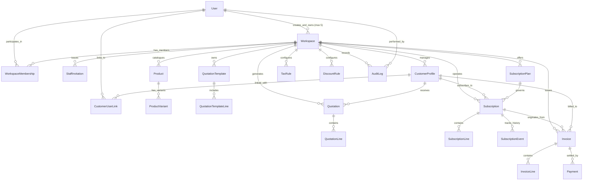

# Brightloop Software — Multi-Tenant Subscription SaaS Platform

## Database Design & Multi-Tenant Entity Relationship Model

**Document Version:** 3.0.0 (Multi-Tenant SaaS Architecture)  
**Target Database Engine:** PostgreSQL 16+  
**Design Principles:** Multi-tenant relational isolation, UUID primary keys, exact decimal currency precision, composite indexes for sub-2-second queries, and transaction-safe 5-workspace limit enforcement.

---

## 1. Multi-Tenant Entity-Relationship Diagram

---

## 2. Multi-Tenant Schema Specifications

### 2.1 Identity & Tenancy (`accounts`, `workspaces`, `invitations`)

#### `accounts_user` (Global User)

- `id`: UUID (Primary Key, default `uuid.uuid4`)
- `email`: VARCHAR(255) UNIQUE NOT NULL (Username field)
- `password`: VARCHAR(255) NOT NULL (Argon2 / PBKDF2)
- `first_name`: VARCHAR(150)
- `last_name`: VARCHAR(150)
- `is_active`: BOOLEAN DEFAULT TRUE
- `is_staff`: BOOLEAN DEFAULT FALSE
- `is_superuser`: BOOLEAN DEFAULT FALSE
- `created_at`, `updated_at`: TIMESTAMP WITH TIME ZONE

#### `workspaces_workspace` (Business Tenant)

- `id`: UUID (Primary Key)
- `name`: VARCHAR(255) NOT NULL
- `slug`: VARCHAR(100) UNIQUE NOT NULL (URL friendly)
- `currency`: VARCHAR(3) DEFAULT 'USD'
- `timezone`: VARCHAR(50) DEFAULT 'UTC'
- `owner`: FK(`accounts_user.id`, on_delete=RESTRICT, related_name='owned_workspaces')
- `is_active`: BOOLEAN DEFAULT TRUE
- `created_at`, `updated_at`: TIMESTAMP WITH TIME ZONE
- **Constraint**: Transactionally enforced maximum of **5 active owned workspaces** per owner user.

#### `workspaces_workspacemembership` (Membership & Roles)

- `id`: UUID (Primary Key)
- `workspace`: FK(`workspaces_workspace.id`, on_delete=CASCADE, related_name='memberships')
- `user`: FK(`accounts_user.id`, on_delete=CASCADE, related_name='workspace_memberships')
- `role`: VARCHAR(20) NOT NULL (`OWNER`, `ADMIN`, `STAFF`, `CUSTOMER`)
- `status`: VARCHAR(20) DEFAULT 'ACTIVE' (`ACTIVE`, `SUSPENDED`)
- `joined_at`: TIMESTAMP WITH TIME ZONE
- **Unique Constraint**: `UNIQUE(workspace_id, user_id)`

#### `invitations_staffinvitation` (Secure Staff Invites)

- `id`: UUID (Primary Key)
- `workspace`: FK(`workspaces_workspace.id`, on_delete=CASCADE, related_name='staff_invitations')
- `invited_by`: FK(`accounts_user.id`, on_delete=SET_NULL, null=True)
- `email`: VARCHAR(255) NOT NULL
- `role`: VARCHAR(20) NOT NULL (`ADMIN`, `STAFF`)
- `token`: VARCHAR(128) UNIQUE NOT NULL (Cryptographically secure random token)
- `status`: VARCHAR(20) DEFAULT 'PENDING' (`PENDING`, `ACCEPTED`, `EXPIRED`, `REVOKED`)
- `expires_at`: TIMESTAMP WITH TIME ZONE NOT NULL
- `created_at`, `updated_at`: TIMESTAMP WITH TIME ZONE
- **Index**: `(workspace_id, email, status)`

### 2.2 Customer Domain (`customers`)

#### `customers_customerprofile` (Workspace Customer)

- `id`: UUID (Primary Key)
- `workspace`: FK(`workspaces_workspace.id`, on_delete=CASCADE, related_name='customers')
- `name`: VARCHAR(255) NOT NULL
- `email`: VARCHAR(255) NOT NULL
- `phone`: VARCHAR(50)
- `billing_address`: TEXT
- `tax_id`: VARCHAR(50)
- `is_active`: BOOLEAN DEFAULT TRUE
- `created_at`, `updated_at`: TIMESTAMP WITH TIME ZONE
- **Unique Constraint**: `UNIQUE(workspace_id, email)`

#### `customers_customeruserlink` (Customer User Portal Binding)

- `id`: UUID (Primary Key)
- `customer_profile`: FK(`customers_customerprofile.id`, on_delete=CASCADE, related_name='user_links')
- `user`: FK(`accounts_user.id`, on_delete=CASCADE, related_name='customer_profiles')
- `created_at`: TIMESTAMP WITH TIME ZONE
- **Unique Constraint**: `UNIQUE(customer_profile_id, user_id)`

### 2.3 Product Catalog & Plans (`catalog`)

#### `catalog_product`

- `id`: UUID (Primary Key)
- `workspace`: FK(`workspaces_workspace.id`, on_delete=CASCADE, related_name='products')
- `name`: VARCHAR(255) NOT NULL
- `code`: VARCHAR(50) NOT NULL (SKU)
- `product_type`: VARCHAR(20) DEFAULT 'software' (`software`, `addon`, `service`, `physical`)
- `sales_price`: DECIMAL(12, 2) NOT NULL DEFAULT 0.00
- `cost_price`: DECIMAL(12, 2) NOT NULL DEFAULT 0.00
- `is_active`: BOOLEAN DEFAULT TRUE
- **Unique Constraint**: `UNIQUE(workspace_id, code)`

#### `catalog_productvariant`

- `id`: UUID (Primary Key)
- `product`: FK(`catalog_product.id`, on_delete=CASCADE, related_name='variants')
- `attribute_name`: VARCHAR(100) NOT NULL
- `attribute_value`: VARCHAR(100) NOT NULL
- `price_delta`: DECIMAL(12, 2) NOT NULL DEFAULT 0.00
- `is_active`: BOOLEAN DEFAULT TRUE
- **Unique Constraint**: `UNIQUE(product_id, attribute_name, attribute_value)`

#### `catalog_subscriptionplan`

- `id`: UUID (Primary Key)
- `workspace`: FK(`workspaces_workspace.id`, on_delete=CASCADE, related_name='plans')
- `name`: VARCHAR(255) NOT NULL
- `code`: VARCHAR(50) NOT NULL
- `billing_interval`: VARCHAR(20) NOT NULL (`daily`, `weekly`, `monthly`, `yearly`)
- `base_price`: DECIMAL(12, 2) NOT NULL DEFAULT 0.00
- `min_seats`: INTEGER DEFAULT 1
- `start_date`: DATE
- `end_date`: DATE
- `auto_close_on_end`: BOOLEAN DEFAULT TRUE
- `allow_early_close`: BOOLEAN DEFAULT TRUE
- `allow_pause`: BOOLEAN DEFAULT TRUE
- `allow_renew`: BOOLEAN DEFAULT TRUE
- `is_active`: BOOLEAN DEFAULT TRUE
- **Unique Constraint**: `UNIQUE(workspace_id, code)`

### 2.4 Quotations & Templates (`quotations`)

#### `quotations_quotationtemplate`

- `id`: UUID (Primary Key)
- `workspace`: FK(`workspaces_workspace.id`, on_delete=CASCADE, related_name='quotation_templates')
- `name`: VARCHAR(255) NOT NULL
- `validity_days`: INTEGER DEFAULT 30
- `plan`: FK(`catalog_subscriptionplan.id`, on_delete=SET_NULL, null=True)

#### `quotations_quotation`

- `id`: UUID (Primary Key)
- `workspace`: FK(`workspaces_workspace.id`, on_delete=CASCADE, related_name='quotations')
- `customer`: FK(`customers_customerprofile.id`, on_delete=RESTRICT, related_name='quotations')
- `plan`: FK(`catalog_subscriptionplan.id`, on_delete=RESTRICT)
- `reference`: VARCHAR(50) NOT NULL
- `status`: VARCHAR(20) DEFAULT 'DRAFT' (`DRAFT`, `SENT`, `APPROVED`, `REJECTED`, `EXPIRED`)
- `subtotal`: DECIMAL(12, 2) DEFAULT 0.00
- `tax_amount`: DECIMAL(12, 2) DEFAULT 0.00
- `discount_amount`: DECIMAL(12, 2) DEFAULT 0.00
- `total_amount`: DECIMAL(12, 2) DEFAULT 0.00
- `valid_until`: DATE NOT NULL
- **Unique Constraint**: `UNIQUE(workspace_id, reference)`

#### `quotations_quotationline`

- `id`: UUID (Primary Key)
- `quotation`: FK(`quotations_quotation.id`, on_delete=CASCADE, related_name='lines')
- `product`: FK(`catalog_product.id`, on_delete=RESTRICT)
- `variant`: FK(`catalog_productvariant.id`, on_delete=SET_NULL, null=True)
- `quantity`: INTEGER DEFAULT 1
- `unit_price`: DECIMAL(12, 2) NOT NULL
- `subtotal`: DECIMAL(12, 2) NOT NULL

### 2.5 Subscriptions (`subscriptions`)

#### `subscriptions_subscription`

- `id`: UUID (Primary Key)
- `workspace`: FK(`workspaces_workspace.id`, on_delete=CASCADE, related_name='subscriptions')
- `customer`: FK(`customers_customerprofile.id`, on_delete=RESTRICT, related_name='subscriptions')
- `plan`: FK(`catalog_subscriptionplan.id`, on_delete=RESTRICT, related_name='subscriptions')
- `reference`: VARCHAR(50) NOT NULL
- `status`: VARCHAR(20) DEFAULT 'DRAFT' (`DRAFT`, `QUOTATION`, `CONFIRMED`, `ACTIVE`, `PAST_DUE`, `PAUSED`, `CLOSED`, `EXPIRED`)
- `payment_terms`: VARCHAR(20) DEFAULT 'due_on_receipt' (`due_on_receipt`, `net_15`, `net_30`, `net_60`)
- `start_date`: DATE NOT NULL
- `expiry_date`: DATE
- `next_billing_date`: DATE NOT NULL
- `currency`: VARCHAR(3) DEFAULT 'USD'
- `subtotal`: DECIMAL(12, 2) DEFAULT 0.00
- `tax_amount`: DECIMAL(12, 2) DEFAULT 0.00
- `discount_amount`: DECIMAL(12, 2) DEFAULT 0.00
- `recurring_total`: DECIMAL(12, 2) DEFAULT 0.00
- **Unique Constraint**: `UNIQUE(workspace_id, reference)`
- **Composite Index**: `(workspace_id, status)`, `(workspace_id, next_billing_date)`

#### `subscriptions_subscriptionline`

- `id`: UUID (Primary Key)
- `subscription`: FK(`subscriptions_subscription.id`, on_delete=CASCADE, related_name='lines')
- `product`: FK(`catalog_product.id`, on_delete=RESTRICT)
- `variant`: FK(`catalog_productvariant.id`, on_delete=SET_NULL, null=True)
- `quantity`: INTEGER DEFAULT 1
- `unit_price`: DECIMAL(12, 2) NOT NULL
- `subtotal`: DECIMAL(12, 2) NOT NULL

#### `subscriptions_subscriptionevent`

- `id`: UUID (Primary Key)
- `subscription`: FK(`subscriptions_subscription.id`, on_delete=CASCADE, related_name='events')
- `previous_status`: VARCHAR(20) NOT NULL
- `new_status`: VARCHAR(20) NOT NULL
- `changed_by`: FK(`accounts_user.id`, on_delete=SET_NULL, null=True)
- `reason`: TEXT
- `timestamp`: TIMESTAMP WITH TIME ZONE DEFAULT timezone.now

### 2.6 Billing, Taxes & Discounts (`billing`, `discounts`)

#### `billing_taxrule`

- `id`: UUID (Primary Key)
- `workspace`: FK(`workspaces_workspace.id`, on_delete=CASCADE, related_name='tax_rules')
- `name`: VARCHAR(100) NOT NULL
- `rate_percentage`: DECIMAL(5, 2) NOT NULL DEFAULT 0.00
- `is_active`: BOOLEAN DEFAULT TRUE

#### `discounts_discountrule`

- `id`: UUID (Primary Key)
- `workspace`: FK(`workspaces_workspace.id`, on_delete=CASCADE, related_name='discount_rules')
- `name`: VARCHAR(100) NOT NULL
- `code`: VARCHAR(50) NOT NULL
- `discount_type`: VARCHAR(20) NOT NULL (`percentage`, `fixed`)
- `value`: DECIMAL(12, 2) NOT NULL
- `scope`: VARCHAR(20) DEFAULT 'subscription' (`product`, `subscription`)
- `min_threshold`: DECIMAL(12, 2) DEFAULT 0.00
- `max_uses`: INTEGER DEFAULT 0 (0 = unlimited)
- `uses_count`: INTEGER DEFAULT 0
- `start_date`: DATE
- `end_date`: DATE
- `is_active`: BOOLEAN DEFAULT TRUE
- **Unique Constraint**: `UNIQUE(workspace_id, code)`

#### `billing_invoice`

- `id`: UUID (Primary Key)
- `workspace`: FK(`workspaces_workspace.id`, on_delete=CASCADE, related_name='invoices')
- `subscription`: FK(`subscriptions_subscription.id`, on_delete=SET_NULL, null=True, related_name='invoices')
- `customer`: FK(`customers_customerprofile.id`, on_delete=RESTRICT, related_name='invoices')
- `invoice_number`: VARCHAR(50) NOT NULL
- `status`: VARCHAR(20) DEFAULT 'DRAFT' (`DRAFT`, `CONFIRMED`, `PAID`, `CANCELLED`)
- `idempotency_key`: VARCHAR(128) UNIQUE NOT NULL
- `issue_date`: DATE NOT NULL
- `due_date`: DATE NOT NULL
- `subtotal`: DECIMAL(12, 2) DEFAULT 0.00
- `tax_amount`: DECIMAL(12, 2) DEFAULT 0.00
- `discount_amount`: DECIMAL(12, 2) DEFAULT 0.00
- `total_amount`: DECIMAL(12, 2) DEFAULT 0.00
- `amount_paid`: DECIMAL(12, 2) DEFAULT 0.00
- `outstanding_balance`: DECIMAL(12, 2) DEFAULT 0.00
- **Unique Constraint**: `UNIQUE(workspace_id, invoice_number)`
- **Composite Index**: `(workspace_id, status)`, `(workspace_id, due_date)`

#### `billing_invoiceline`

- `id`: UUID (Primary Key)
- `invoice`: FK(`billing_invoice.id`, on_delete=CASCADE, related_name='lines')
- `product`: FK(`catalog_product.id`, on_delete=RESTRICT)
- `variant`: FK(`catalog_productvariant.id`, on_delete=SET_NULL, null=True)
- `quantity`: INTEGER DEFAULT 1
- `unit_price`: DECIMAL(12, 2) NOT NULL
- `subtotal`: DECIMAL(12, 2) NOT NULL

### 2.7 Payments (`payments`)

#### `payments_payment`

- `id`: UUID (Primary Key)
- `workspace`: FK(`workspaces_workspace.id`, on_delete=CASCADE, related_name='payments')
- `invoice`: FK(`billing_invoice.id`, on_delete=RESTRICT, related_name='payments')
- `amount`: DECIMAL(12, 2) NOT NULL
- `payment_method`: VARCHAR(30) DEFAULT 'credit_card' (`credit_card`, `bank_transfer`, `cash`, `check`, `online`)
- `transaction_reference`: VARCHAR(100)
- `payment_date`: DATE NOT NULL
- `recorded_by`: FK(`accounts_user.id`, on_delete=SET_NULL, null=True)
- `notes`: TEXT

### 2.8 Audit Logging (`audit`)

#### `audit_auditlog`

- `id`: UUID (Primary Key)
- `workspace`: FK(`workspaces_workspace.id`, on_delete=CASCADE, related_name='audit_logs', null=True)
- `user`: FK(`accounts_user.id`, on_delete=SET_NULL, null=True)
- `action`: VARCHAR(100) NOT NULL
- `entity_type`: VARCHAR(50) NOT NULL
- `entity_id`: VARCHAR(50) NOT NULL
- `payload`: JSONB DEFAULT dict
- `timestamp`: TIMESTAMP WITH TIME ZONE DEFAULT timezone.now
- **Index**: `(workspace_id, timestamp)`
