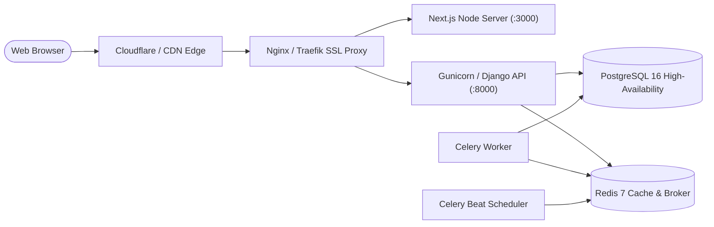

# Brightloop Software — Subscription Management System
## Production Deployment & Operational Guide

---

## 1. Production Architecture Overview

In production, Brightloop operates as a containerized or managed cloud deployment:



---

## 2. Environment Variables Checklist

Ensure these variables are provided in production:

| Variable | Description | Recommendation |
|---|---|---|
| `ENVIRONMENT` | Runtime mode | `production` |
| `DEBUG` | Django debug toggle | `False` |
| `SECRET_KEY` | Cryptographic key | Generate with `openssl rand -hex 32` |
| `ALLOWED_HOSTS` | Whitelisted hostnames | Domain name(s) e.g., `app.brightloop.com` |
| `DB_ENGINE` | Database backend | `django.db.backends.postgresql` |
| `DB_NAME` | Database name | Dedicated production database |
| `DB_USER` / `DB_PASSWORD` | DB Credentials | Secure generated credentials |
| `DB_HOST` / `DB_PORT` | Postgres host & port | RDS / Cloud SQL cluster address |
| `REDIS_URL` | Redis connection URL | Managed Redis / ElastiCache instance |
| `JWT_COOKIE_SECURE` | HTTPS cookie flag | `True` |

---

## 3. Database Migration & Deployment Order

1. **Pre-flight**:
   ```bash
   python manage.py check --deploy
   ```
2. **Execute Migrations**:
   ```bash
   python manage.py migrate --noinput
   ```
3. **Collect Static Files**:
   ```bash
   python manage.py collectstatic --noinput
   ```
4. **Start Application Containers**:
   ```bash
   docker compose up -d
   ```

---

## 4. Recurring Billing Automation

To guarantee zero billing skips in production, ensure Celery Beat is running or schedule a system cron:

```bash
# Cron alternative (daily at 00:05 UTC)
5 0 * * * cd /path/to/app && python manage.py run_billing_cycle
```
