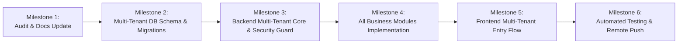

# Brightloop Software — Multi-Tenant Subscription SaaS Platform

## Master Multi-Tenant Implementation Plan

---

## 1. Migration Phasing & Milestones

---

### Milestone 1: Audit, Goal Revision & Architecture Documentation

- [x] Inspect existing single-company assumptions and preserve working foundations.
- [x] Create feature branch `feature/multi-tenant-saas-backend`.
- [x] Overhaul canonical documentation: `README.md`, `docs/REQUIREMENTS.md`, `docs/ARCHITECTURE.md`, `docs/DATABASE_DESIGN.md`, `docs/API_DESIGN.md`, `docs/API_CATALOG.md`, `docs/API_PERMISSION_MATRIX.md`, `docs/SECURITY.md`.

### Milestone 2: Multi-Tenant Database Schema & Migrations

- [ ] Migrate models to UUID identifiers across all apps.
- [ ] Implement `workspaces` app (`Workspace` with max 5 owner limit, `WorkspaceMembership` with roles `OWNER`, `ADMIN`, `STAFF`, `CUSTOMER`).
- [ ] Implement `invitations` app (`StaffInvitation` with cryptographic expiring tokens).
- [ ] Update `customers` app (`CustomerProfile` with `workspace` FK and `CustomerUserLink`).
- [ ] Update `catalog`, `quotations`, `subscriptions`, `billing`, `payments`, `discounts`, `reporting`, and `audit` with `workspace` FKs and relational constraints.
- [ ] Generate and apply database migrations safely.

### Milestone 3: Multi-Tenant REST APIs & Tenant Isolation Guard

- [ ] Implement global auth & profile endpoints (`/api/v1/auth/*`).
- [ ] Implement workspace management endpoints (`/api/v1/workspaces/` with 5-workspace limit enforcement).
- [ ] Implement staff invitation generation and token-based acceptance endpoints (`/api/v1/invitations/accept/`).
- [ ] Implement tenant isolation mixin/permission class ensuring automatic `workspace_id` filtering on all querysets and preventing cross-tenant access.

### Milestone 4: Backend Business Modules & Celery Automation

- [ ] Implement workspace-scoped Customers, Products, Variants, and Subscription Plans.
- [ ] Implement Quotations, Templates, Subscriptions lifecycle state transitions.
- [ ] Implement Invoices, Tax Rules, Discount Rules, and Idempotent Recurring Billing Engine.
- [ ] Implement Payments and Atomic Invoice Settlement.
- [ ] Implement Dashboard Summary API and Reporting Aggregations.
- [ ] Implement Audit Logging on critical events.
- [ ] Implement Celery scheduled tasks with tenant workspace context.

### Milestone 5: Frontend Multi-Tenant Entry Flow

- [ ] Public landing page: Headline _"Run Your Subscription Business. All in One Place."_ with _"Start Your Business"_ and _"Sign In"_.
- [ ] Workspace creation modal/view with active slot counter (e.g. 1/5 used).
- [ ] Workspace switcher in header/sidebar.
- [ ] Staff invitation acceptance page (`/invitations/accept?token=...`).
- [ ] Role-specific navigation (Owner/Admin vs Staff limited vs Customer Portal).

### Milestone 6: Quality Verification, Test Suites & Remote Push

- [ ] Automated tenant isolation tests (proving Workspace B cannot access Workspace A data).
- [ ] 5-workspace limit enforcement tests.
- [ ] Role permission tests (Staff limited power vs Admin approval).
- [ ] Financial calculation & idempotent billing tests.
- [ ] Frontend build & tests.
- [ ] Commit all changes using Conventional Commits.
- [ ] Push `feature/multi-tenant-saas-backend` to GitHub remote.
- [ ] Produce `docs/BACKEND_COMPLETION_REPORT.md`.
