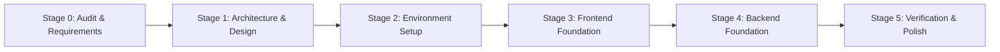

# Brightloop Software — Subscription Management System
## Master Implementation Plan

---

## Stage Overview & Phasing

---

### Stage 0: Repository and Requirements Audit (Completed)
- [x] Workspace inspection and runtime verification (Python 3.12, uv 0.11, Node 22, pnpm 11, Docker 29, Git 2.45).
- [x] Full analysis of `Subscription_Management_System_goal.pdf`.
- [x] Initialized Git repository, structured `.gitignore`, created dedicated `develop` branch.
- [x] Formulated `docs/REQUIREMENTS.md` and `docs/OPEN_QUESTIONS.md`.

### Stage 1: Architecture & Design Planning (In Progress)
- [x] Finalize directory structure (`apps/web`, `apps/api`, `docs`, `infrastructure`).
- [ ] Document Domain Architecture in `docs/ARCHITECTURE.md`.
- [ ] Document Database Schema and Relationships in `docs/DATABASE_DESIGN.md`.
- [ ] Define minimal REST API contracts in `docs/API_DESIGN.md`.
- [ ] Formulate UI Design System tokens and layout guidelines in `docs/DESIGN_SYSTEM.md`.
- [ ] Initialize `docs/BUILD_LOG.md`.

### Stage 2: Environment Setup & Infrastructure
- [ ] Initialize Next.js 14/15 App Router in `apps/web` with TypeScript, Tailwind CSS, Lucide icons, and shadcn/ui.
- [ ] Initialize Django REST Framework backend in `apps/api` using `uv`.
- [ ] Configure `pyproject.toml` with Ruff, Pytest, SimpleJWT, drf-spectacular, django-filter, celery, redis, psycopg2/psycopg.
- [ ] Provide `docker-compose.yml` for PostgreSQL, Redis, Celery worker/beat, and backend services.
- [ ] Create `.env.example` with secure production-ready configurations.
- [ ] Configure CORS, SimpleJWT cookie/header strategy, and OpenAPI schema generation.
- [ ] Implement system health-check endpoint (`/api/v1/health/`).

### Stage 3: Frontend Foundation
- [ ] Establish enterprise SaaS app shell (collapsible sidebar, command topbar, user profile switcher).
- [ ] Implement role-based navigation (Admin vs. Staff vs. Customer portal preview).
- [ ] Build reusable UI kit components (Card, Button, Badge, Modal, Form inputs, DataTable, StatCard).
- [ ] Develop Dashboard with Financial KPI cards (MRR, Active Subscriptions, Overdue, Revenue) and Recharts trend visualization.
- [ ] Create core management module layouts:
  - Subscriptions view with status filters (`Draft`, `Quotation`, `Confirmed`, `Active`, `Closed`).
  - Catalog & Plan manager (Products, Variants, Billing intervals).
  - Invoices & Billing manager with automated run trigger and payment recording modal.
  - Customer Portal self-service view.
- [ ] Construct typed API client layer with TanStack Query and error boundary handling.

### Stage 4: Backend Foundation & Domain Implementation
- [ ] Configure Django core apps:
  - `accounts`: Custom User model, Roles (`admin`, `staff`, `customer`), SimpleJWT auth, customer registration with strong password validator.
  - `customers`: Customer profiles, billing addresses, contact info.
  - `catalog`: Product, ProductVariant, SubscriptionPlan models.
  - `quotations`: QuotationTemplate, QuotationTemplateLine.
  - `subscriptions`: Subscription, SubscriptionLine, status state transitions.
  - `billing`: TaxRule, DiscountRule, Invoice, InvoiceLine, automated idempotent billing engine.
  - `payments`: Payment records, invoice balance updates, overdue calculation.
  - `reporting`: Consolidated dashboard aggregation endpoint with high-efficiency SQL.
- [ ] Run initial migrations.
- [ ] Register all models into Django Admin with clean search/filter interfaces.
- [ ] Configure drf-spectacular OpenAPI `/api/schema/` and Swagger UI `/api/docs/`.
- [ ] Setup Celery task stubs for recurring billing and renewal checks.

### Stage 5: Verification & Documentation
- [ ] Verify frontend build (`pnpm run build`).
- [ ] Verify backend migrations and check (`python manage.py check`).
- [ ] Run automated tests with `pytest`.
- [ ] Run lint checks with `ruff check .` and frontend lint.
- [ ] Validate end-to-end communication via health check and API responses.
- [ ] Deliver comprehensive `README.md`, `docs/SETUP_REPORT.md`, and updated `docs/BUILD_LOG.md`.

