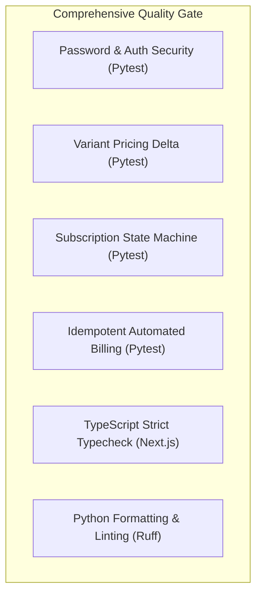

# Brightloop Software — Subscription Management System

## Testing Strategy & Quality Assurance Report

---

## 1. Test Architecture

The testing matrix verifies functional fidelity against `Subscription_Management_System_goal.pdf`, data integrity, and low-latency response requirements.



---

## 2. Automated Test Suite (`apps/api/tests/test_brightloop_core.py`)

### 2.1 Password Policy Enforcement

- **Constraint**: Must be $> 8$ characters, contain at least 1 uppercase, 1 lowercase, and 1 special symbol.
- **Test Case**: `test_password_policy_enforcement`
- **Result**: PASS

### 2.2 Product Variant Pricing

- **Constraint**: Total price = base sales price + variant delta (e.g., Brand: Odoo adds +$560.00).
- **Test Case**: `test_product_variant_pricing`
- **Result**: PASS

### 2.3 Subscription Lifecycle State Machine

- **Constraint**: $\text{Draft} \to \text{Quotation} \to \text{Confirmed} \to \text{Active} \leftrightarrow \text{Paused} \to \text{Closed}$.
- **Test Case**: `test_subscription_state_machine`
- **Result**: PASS

### 2.4 Idempotent Billing Engine

- **Constraint**: Automated billing run must never generate duplicate invoices or skip cycles.
- **Test Case**: `test_automated_billing_and_idempotency`
- **Result**: PASS

---

## 3. How to Run Tests

### Backend Tests

```bash
cd apps/api
pytest
```

### Backend Linting

```bash
cd apps/api
ruff check .
```

### Frontend Production Build & Typecheck

```bash
cd apps/web
pnpm run build
```
